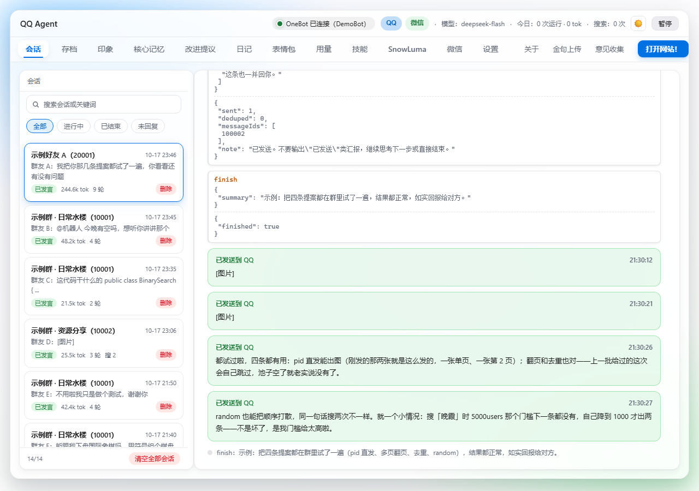
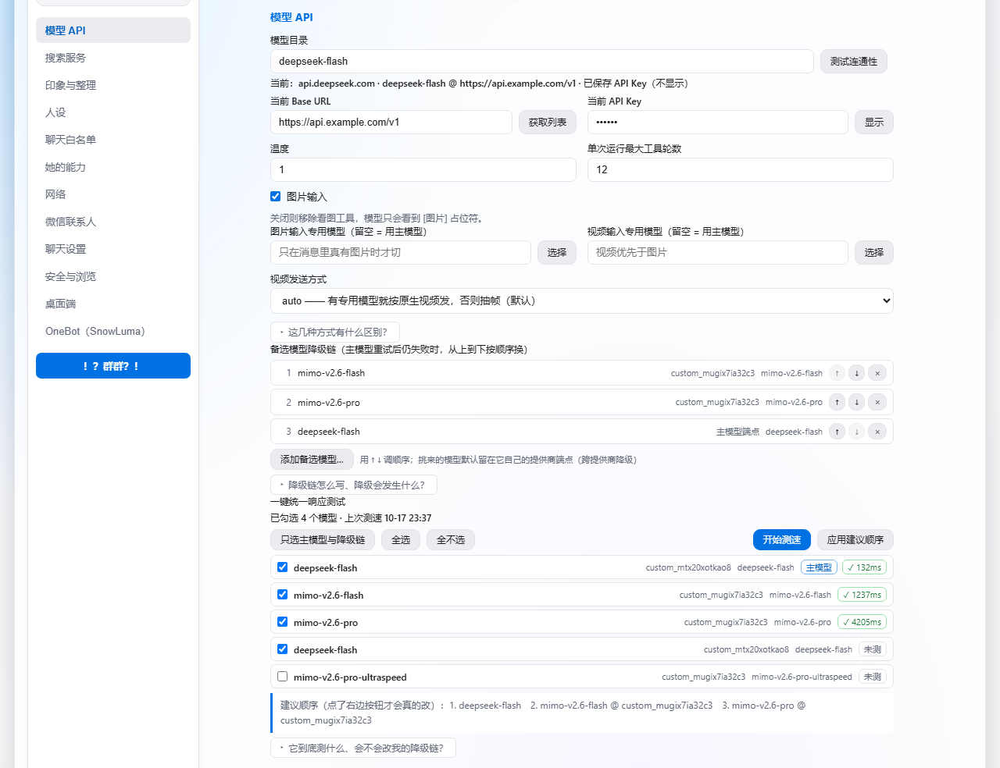
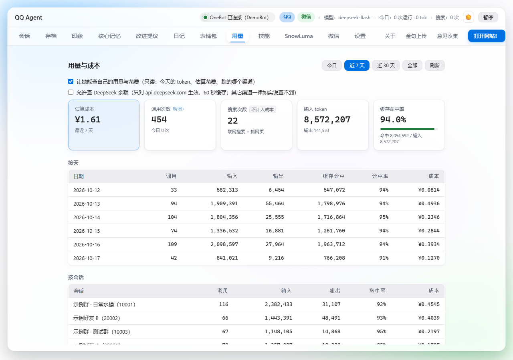

# QQ Agent（独立版 · 桌面端）

**跑在你自己电脑上的 QQ 群 AI 机器人**：每次唤醒开一个独立会话，成本恒定可控。


QQ 群 AI 机器人（桌面版）：事件驱动的无状态 Agent，接 OpenAI 兼容 API，带会话式控制台。

> ⚠️ **非官方修改版（Fan-made Version）**
> 本项目是 [K0nd1us/QQ-agent](https://github.com/K0nd1us/QQ-agent) 的修改版，由
> [@charovo0059](https://github.com/charovo0059) 在原版 **v0.3.0** 基础上自行改造，并合并过上游 0.4 系列的一部分。
> 原版作者是 **Kondius**，项目以 **MIT 许可**开源 —— **没有原版就没有这个仓库**。
> 本仓库不是上游的官方分支，改动按个人自用需求推进，**不保证与上游同步**，也不代表原作者的立场或质量背书。
> 有问题请提到**本仓库**的 issue，不要去打扰原作者。

## 界面







> 三张都是**离线渲染的界面示意**（拿真实渲染函数 + 真实 CSS + 脱敏后的配置数据跑出来的），
> 不是真机截图 —— 所以里面的人名、群号、Key 全是编的。

## 她能干什么

- **像一个群友那样说话**：分条回复、引用、@ 人、拍一拍；表情包积极程度 0~3 档；
  对方发图发视频时切到视觉模型看图。
- **响应档位一条滑条调**：1 档只回 @、2 档加关键词、3 档按概率接话、4 档全回应。
  **没命中就不调模型**（零 token），连"等待中"的会话都不会留下。
- **只在她允许的地方说话**：白名单里的群/好友才能收到消息，从 QQ 账号直接勾选；发送另有强制限频。
- **记得住人**：每个群友一份长期印象，可手动编辑、可「更新记忆」从聊天记录里提炼；跨会话持久。
- **会自己上网查**：`web_search` + `web_fetch`，6 家搜索服务可选、也能自己加任意兼容服务；
  抓回来的网页正文会先净化再交给模型（防提示注入、防内网探测）。
- **图搜与番剧桥**：pixiv 图搜（按 pid 直发、多页作品、翻页/随机/同轮去重）、JM 桥与随包技能。
- **群管理与提案**：她可以把自己的判断做成「提案」交给管理员裁决；禁言表；发送失败可见、可重发。
- **模型随便换**：任何 OpenAI 兼容 API 都行。多提供商目录 + 大列表搜索分栏、
  **备选模型降级链**、**一键统一响应测试**（只给建议顺序，绝不自己改配置）。
- **把成本压成常数**：无状态会话 + 前缀缓存友好排序，会话里能看缓存命中率；
  内置 139 条官方价格表、支持峰谷分时与逐次调用精算。
- **桌面端小工具**：托盘常驻、开机自启、首次配置有「体检卡」盯着、明暗双主题、失败自动重试。
- **一个控制台看全部**：会话（完整提示词/思考/工具调用/实际发出的每条）、存档、记忆、用量、设置。
- **能自己长**：`skills/` 随包技能 + `plugins/` 插件（有权限声明与绊线式扫描，见 `plugins/README.md`）。

## 三分钟跑起来

需要 Windows + Node.js 20 以上。

1. **准备协议端**：机器人靠 [SnowLuma](https://github.com/SnowLuma)（或任何提供 OneBot v11 正向 WebSocket 的项目）连上 QQ。
   自行获取后把整个文件夹放进项目根目录，**目录名保持 `snowluma`**（`.gitignore` 已排除，不会被提交）。
   这一步不能省，仓库里**不含**它：它是第三方独立项目、自带 EULA 与"源码可见非商业许可"，随仓库再分发可能违反条款。
2. **装依赖并启动**：

   ```bash
   npm install
   npm start          # 等价于双击根目录的 启动QQ机器人.bat
   npm run server     # 只要后端：浏览器打开 http://127.0.0.1:3210
   ```

3. **第一次进去照着「体检卡」走**：填接口地址（任何 OpenAI 兼容地址 + Key）、选模型（点「获取列表」自动拉）、
   配白名单（点「选择群」直接勾）。启动 SnowLuma 扫码登录并保持运行，看控制台左上角状态点变绿即可。
4. **验链路**：到「存档」页给目标群手动发一条测试消息，通了就可以等群友说话。

## 技术亮点（为什么这么设计）

- **无状态会话把平方级成本压成常数**：原版把上下文堆在一个会话里、每次发言重发全部历史，成本随发言次数近似平方增长；
  本版把聊天记录存成 JSON 存档，每次唤醒**新开独立会话**，提示词 = 静态系统提示 + 存档摘要 + 本次新消息，结束即弃置。
  而且提示词块是**按"变化频率"排序**的，好让前缀缓存命中 —— 顺序错了会白付一遍钱（实测那一处占未命中 token 的 63%）。
- **响应档位滑条**：群聊大部分消息不需要回应。做成一条无级滑条（分四段、中间 70% 概率线性 0→100%），
  关键设计是**触发原因决定上下文长度**：设为 3 档时被 @ 触发，带的仍是 1 档的条数 —— 被艾特是最明确的召唤，值得更多上下文。
- **零框架前端却有完整设计系统**：纯 HTML + CSS + JS（"控制台要能双击就开"），但做了设计 token 分层、
  明/暗/跟随系统三态主题（首屏不闪）、动效 token、`prefers-reduced-motion` 降级、长列表只保留合成层属性过渡。
- **用量统计 195ms → 23ms**：遍历全部会话文件很慢，加了目录快照 + TTL 双保险缓存（会话文件是"结束写一次、之后不改"），
  明细下钻 141ms → 1ms。首次加载有骨架屏。
- **工具天然绑定会话**：发送类工具只能发到当前会话，模型无法发到别处（比令牌机制更强）；
  抓网页有完整 SSRF 防护（DNS 校验、防 rebinding、手动跟重定向、限量读取）。

推导过程、实测数据与逐条设计取舍见 [`docs/架构说明.md`](docs/架构说明.md)，界面与功能的细节版见 [`docs/功能说明.md`](docs/功能说明.md)。

## 与上游的差别

与**上游当前版本 0.4.0**（`main` 分支 `fdfd325e`，2026-10-17；上游没给 0.4.0 打 tag）逐字节比对：

| 类别 | 数量 |
|---|---|
| 逐字节相同 | 3 |
| 本版独有 | 45 |
| 双方都有、内容不同 | 52 |
| 上游有、本版没有 | 94 |

对账口径：本版跟踪 **100** 个文件、上游 **149** 个（按 `git ls-files` 逐名比、同名再比 sha256；
`docs/` 这个文档目录不计入）。**双方都有、内容不同**那 52 个才是"分叉"的主体 —— 技能/插件、图片视频处理、
`app.js`、`orchestrator.js`、`prompt.js`、`memory.js`、`tools.js`、`llm.js`、前端一套都在里面，是**各自实现的同名子系统**，
不是本版独有的发明。上游有而本版没有的主要是它的测试套件、社区/市场/人设广场那一整套（有意不跟）与扩展开发文档。

逐文件明细、未收录的理由、以及"为什么基线用 0.4.0 而不是 v0.3.0"，见 [`docs/版本对比.md`](docs/版本对比.md)。
上游 v0.3.0 的 README 原文存档在 [`docs/上游README-v0.3.0.md`](docs/上游README-v0.3.0.md)。

## 目录结构

```
├── 启动QQ机器人.bat        一键启动（Windows）
├── package.json
├── src/                     后端：会话编排、工具、记忆、搜索、用量、通道
├── ui/                      控制台前端（零框架）：index.html + style.css + app/ 20 段拆分
├── electron/                Electron 壳与 preload
├── skills/                  随包技能（盘外挂载，见 skills/）
├── plugins/                 插件目录（默认空，写法见 plugins/README.md）
├── assets/                  图标
├── docs/                    这份文档的细节层（架构、功能、版本对比、价格表）
├── data/                    运行时数据：配置、消息存档、会话记录、印象（⛔ 不进版本库）
└── snowluma/                协议端，自己放进来（⛔ 不进版本库）
```

## 名词解释

| 词 | 意思 |
|---|---|
| **SnowLuma** | 第三方 QQ 协议端，提供 OneBot v11 接口。机器人只通过 WebSocket 跟它说话，不包含它的代码。 |
| **OneBot v11** | 机器人协议标准；任何实现它的协议端都能替换 SnowLuma。 |
| **白名单** | 允许机器人说话的群与好友清单。不在名单里的会话，她完全不响应。 |
| **档位** | 响应积极程度（1~4 档），决定"什么消息值得回"以及回带多少条已读历史。 |
| **印象** | 模型为某个群友记下的长期记忆，跨会话持久，可在「记忆」页看到与编辑。 |
| **提案** | 模型把自己的判断（如"这条 R-18 该不该发"）交给管理员裁决的机制，可在「提案」页处理。 |
| **核心记忆** | 与聊天存档解耦的长期记忆层，解决"会话结束即弃置"后的记忆连续性问题。 |
| **降级链** | 主模型调不通时依次尝试的备选模型清单（模型 + 提供商）。 |

## 测试

⚠️ **`npm test` 在这个仓库里不存在** —— `package.json` 的 scripts 只有 `start` 与 `server`。
这个项目的判据住在**工作区根目录**的 `测试-现行/` 里，与源码树分开。跑法只有一条：

```bash
node 跑一遍所有验证.mjs
```

它按分类表跑离线判据（`manual` / `needs-net` / `needs-api` 会明确跳过并报出条数），打印「通过 N / N、合计 M 项断言、耗时 Ns」，
完整输出落到根目录的 `回归测试-<时间戳>.log`。⚠️ **判据条数与断言数不写在这里**：它每一轮都在涨，写进来就成了一份必然过期的数据。

它值得存在的理由：`node --check` 对"未定义变量"这类运行时错误**完全无感** —— 项目里真出过一次
（模板用了未声明的变量，语法检查通过、页面却整个打不开）。所以判据里有三类硬骨头：**渲染真跑**（真的执行设置页渲染函数）、
**打桩验行为**（把 `fs.writeFileSync` 打成 ENOSPC，验"落盘失败不丢数据"）、**变异验证**（把实现改坏，判据必须变红）。

## 内置模型价格表

收录 **139** 个模型的输入/输出/缓存命中单价、峰谷价与图片计费规则，完整表格见 [`docs/model-prices.md`](docs/model-prices.md)
（由 [`docs/模型价格表生成.mjs`](docs/模型价格表生成.mjs) 从 `src/model-prices.js` 自动生成 —— 要改价格请改源码再重跑，⛔ 别手改文档）。

## 致谢

- **[Derpyu520/qq-bridge](https://github.com/Derpyu520/qq-bridge)** —— 本项目由其彻底改造而来。
  人设模板、Markdown 转纯文本、二代仿真 preset 的行为规则均移植自该项目（已获原作者授权）。
- **[K0nd1us/QQ-agent](https://github.com/K0nd1us/QQ-agent)**（原作者 **Kondius** / 李永前）—— 本版所基于的原项目。
- **SnowLuma** —— 提供 QQ 协议端，是机器人能连上 QQ 的实际通道（独立第三方项目，不受本项目许可覆盖）。

## 许可

本项目采用 **MIT 许可**（见 [LICENSE](LICENSE)）—— 可自由使用、修改、分发，包括商业用途，只需保留版权声明。
版权归原作者 **Kondius** 所有；本版的改动部分同样以 MIT 许可提供，再分发时请保留原版署名。

> 注意：作为前置依赖的 **SnowLuma 是独立项目**，有其自身的 EULA 与"源码可见非商业许可"，**不受本项目的 MIT 许可覆盖**。

